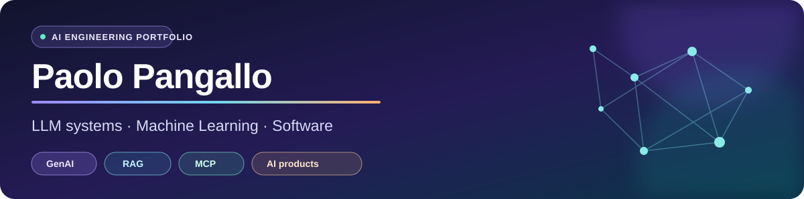

 

**M.Sc. candidate in Computer Engineering — Artificial Intelligence · University of Calabria 🇮🇹**

I build AI systems that connect **models, tools, data and real applications**.

## ✦ Featured projects

<table>
<tr>
<td width="50%" valign="top">

### 🛍️ [MCP E-Commerce](https://github.com/PaoloPangallo/MCP_E-commerce)

**Agentic AI · MCP · RAG**

AI-assisted shopping platform integrating tool-driven agents, eBay, semantic search, seller analysis and user context with a full-stack web application.

  

[**Explore architecture →**](https://github.com/PaoloPangallo/MCP_E-commerce#architecture)

</td>
<td width="50%" valign="top">

### 🧬 [MTB GraphRAG](https://github.com/PaoloPangallo/MTB_GRAPH_RAG)

**LLMs · Knowledge Graphs · Evidence verification**

Master's thesis prototype exploring traceable retrieval, controlled orchestration and verifiable evidence for Molecular Tumor Boards.

  

[**Explore research →**](https://github.com/PaoloPangallo/MTB_GRAPH_RAG#architecture)

</td>
</tr>
<tr>
<td width="50%" valign="top">

### 🛒 [Full-Stack E-Commerce](https://github.com/PaoloPangallo/PSW_Ecommerce)

**Software architecture · Java · Angular**

Complete commerce application with authentication, product management, cart, orders, persistence and REST APIs.

 

[**Explore application →**](https://github.com/PaoloPangallo/PSW_Ecommerce)

</td>
<td width="50%" valign="top">

### 🐙 [Cephalopod AI](https://github.com/PaoloPangallo/IA_Cephalopod)

**Search · Reinforcement Learning · Neural agents**

Game-playing AI experiments spanning Minimax, Alpha-Beta, MCTS, behavior cloning and AlphaZero-style agents.

 

[**Explore algorithms →**](https://github.com/PaoloPangallo/IA_Cephalopod)

</td>
</tr>
</table>

## ⚡ More applied AI

| Project | What it explores |
| :-- | :-- |
| [LLM + PDDL Planning](https://github.com/PaoloPangallo/PDDL_LLM) | Neuro-symbolic workflows: LLM generation, symbolic validation and refinement |
| [Graph Paper Recommender](https://github.com/PaoloPangallo/Data-Mining-Streamlit) | Graph embeddings, GNN experiments and metadata-aware recommendation |
| [Cable Instance Segmentation](https://github.com/PaoloPangallo/Cable-Instance_Segmentation) | Vision Transformers and geometry-aware computer vision |
| [Traffic Signal MARL](https://github.com/PaoloPangallo/SUMO_MARL) | Multi-agent reinforcement learning in SUMO simulations |

## 🧰 Toolkit

**AI / ML**

**Engineering**

## 🎯 What I'm looking for

I'm completing my Master's thesis in AI at the University of Calabria and looking for a **junior AI/ML, GenAI or AI software engineering** opportunity. I especially enjoy teams building usable products with reliable retrieval, well-defined tool integrations, APIs and evaluation.

**Let's connect and build something useful.**

